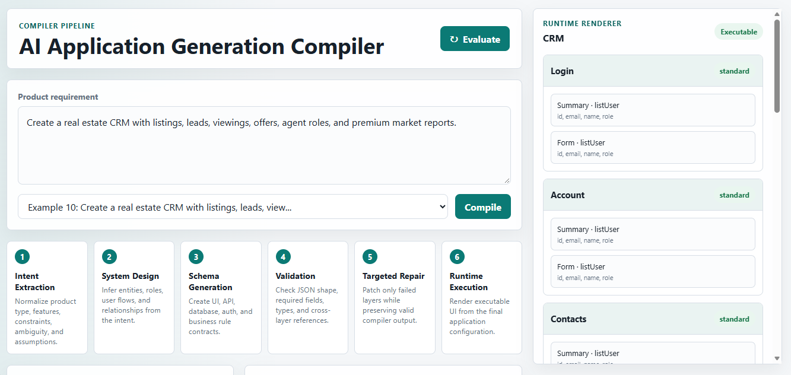
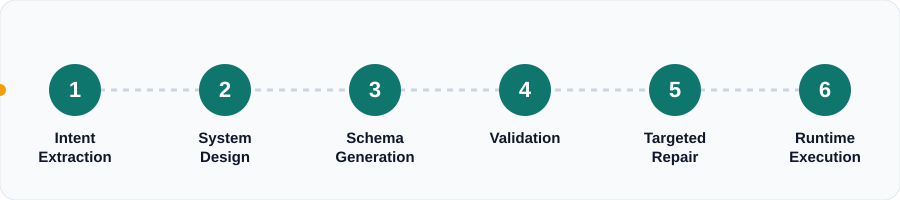
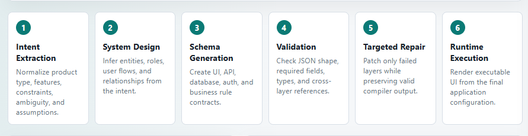
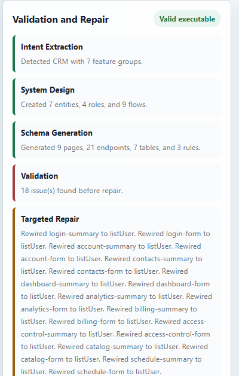
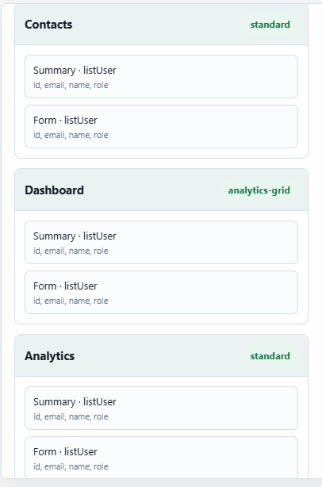
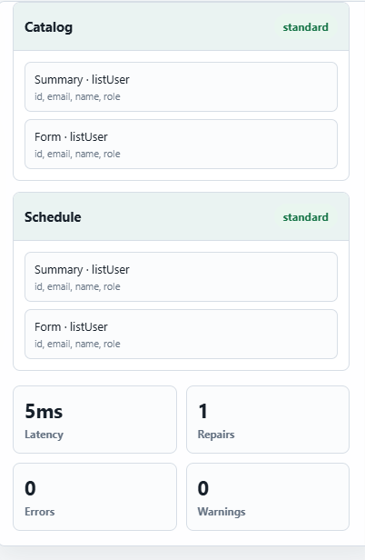
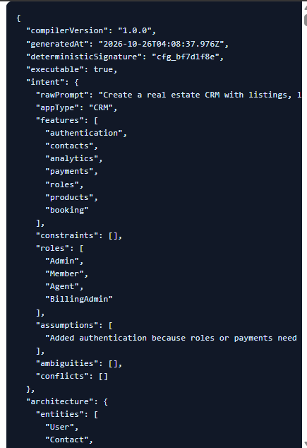

<p align="center">
  
</p>

<p align="center">
  
  
  
  
  
</p>

<p align="center">
  <b>A self-contained demo for the AI Engineer internship task.</b><br/>
  It behaves like a small <i>compiler for app generation</i> — turning a plain-English idea into a validated, repaired, executable application config.
</p>

---

## 🎬 Live Demo Preview

<p align="center">
  
</p>

> Type a product requirement → hit **Compile** → inspect the pipeline, the validation/repair log, the generated JSON, and the live runtime preview.

---

## 🧭 How It Works

```text
Natural language ─▶ intent ─▶ architecture ─▶ schemas ─▶ validation ─▶ repair ─▶ executable config ─▶ runtime preview
```

<p align="center">
  
</p>

<p align="center">
  
</p>

| # | Stage | What it does |
|---|-------|--------------|
| 1 | **Intent Extraction** | Normalizes product type, features, constraints, ambiguity, and assumptions |
| 2 | **System Design** | Infers entities, roles, user flows, and relationships from the intent |
| 3 | **Schema Generation** | Creates UI, API, database, auth, and business-rule contracts |
| 4 | **Validation** | Checks JSON shape, required fields, types, and cross-layer references |
| 5 | **Targeted Repair** | Patches only failed layers while preserving valid compiler output |
| 6 | **Runtime Execution** | Renders executable UI from the final application configuration |

---

## ✨ Features

- 🧱 **Multi-stage pipeline** with clear stage separation in `app.js`
- 🎯 **Deterministic**, rule-based intent extraction and architecture generation
- 📐 **Strict config shape** covering UI, API, database, auth, and business rules
- 🔍 **Cross-layer validator** for missing keys, type shape, hallucinated fields, missing endpoints, role permissions, and UI/API/DB consistency
- 🩹 **Targeted repair engine** that patches invalid sections instead of blindly regenerating everything
- 🖥️ **Lightweight runtime renderer** that turns final JSON into executable UI panels
- 📊 **Evaluation dataset** — 10 standard prompts + 10 edge cases
- ⏱️ **Metrics** for success rate, repair count, failure categories, and latency

---

## 🩺 Validation & Repair in Action

For the prompt *"Create a real estate CRM with listings, leads, viewings, offers, agent roles, and premium market reports."* the compiler found **18 issues** and fixed them with targeted rewiring (UI components → `listUser`) — no full regeneration needed.

<p align="center">
  
</p>

---

## 🖥️ Runtime Preview

The runtime only renders configs that pass cross-layer checks — proof of *execution awareness*, not decorative JSON.

<table align="center">
  <tr>
    <td align="center"><br/><sub>Contacts · Dashboard · Analytics</sub></td>
    <td align="center"><br/><sub>Catalog · Schedule · Run metrics</sub></td>
  </tr>
</table>

Final run: **5 ms latency · 1 repair pass · 0 errors · 0 warnings**.

---

## 📦 Generated Config

<p align="center">
  
</p>

```jsonc
{
  "compilerVersion": "1.0.0",
  "deterministicSignature": "cfg_bf7d1f8e",
  "executable": true,
  "intent": {
    "appType": "CRM",
    "features": ["authentication", "contacts", "analytics", "payments", "roles", "products", "booking"],
    "roles": ["Admin", "Member", "Agent", "BillingAdmin"]
  },
  "architecture": { "entities": ["User", "Contact", "..."] }
}
```

---

## 🚀 Run Locally

Any static server works. From the project folder:

```bash
python -m http.server 4173
```

Then open **http://localhost:4173** — or simply open `index.html` directly in a browser.

## 🧪 How to Test

1. Enter a product prompt.
2. Click **Compile**.
3. Inspect the generated JSON, validation/repair log, and runtime preview.
4. Click **Evaluate** to run the 20-case dataset and attach real metrics to the output config.

---

## 🧠 Design Notes

This implementation intentionally avoids relying on a single LLM prompt. The pipeline is **deterministic and modular**, so each layer can be independently validated, repaired, and later replaced with an LLM-backed implementation.

> **The validator is the control point.** The runtime only renders configurations that pass cross-layer checks.

---

## 📁 Project Structure

```text
.
├── index.html
├── app.js
├── README.md
└── assets/
    ├── banner.svg                  # animated header
    ├── pipeline-flow.svg           # animated pipeline
    ├── dashboard-overview.png
    ├── pipeline-stages.png
    ├── validation-repair.png
    ├── runtime-preview-1.png
    ├── runtime-preview-2-metrics.png
    ├── config-json.png
    └── header-crop.png
```

<p align="center"><sub>Built for the AI Engineer internship task · Deterministic · Modular · Executable</sub></p>
